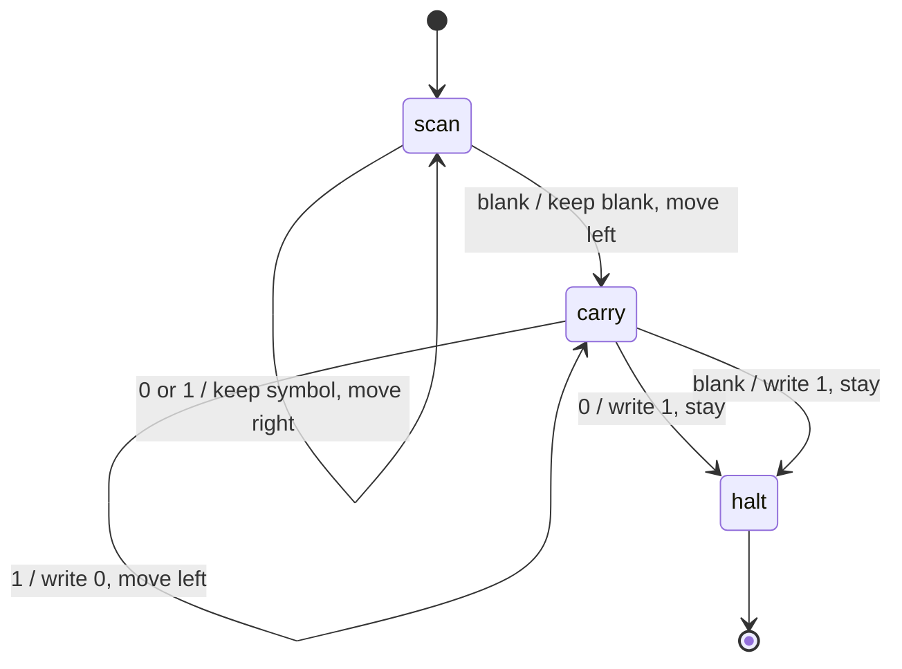
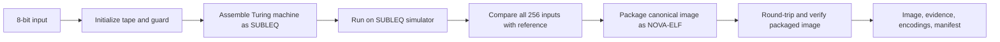
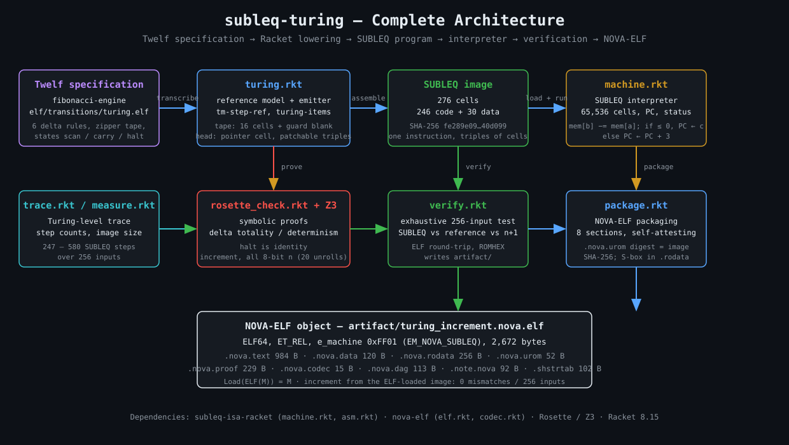
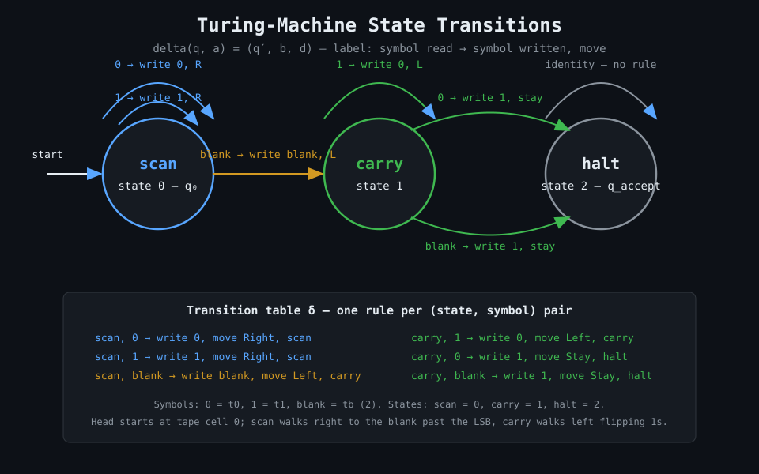
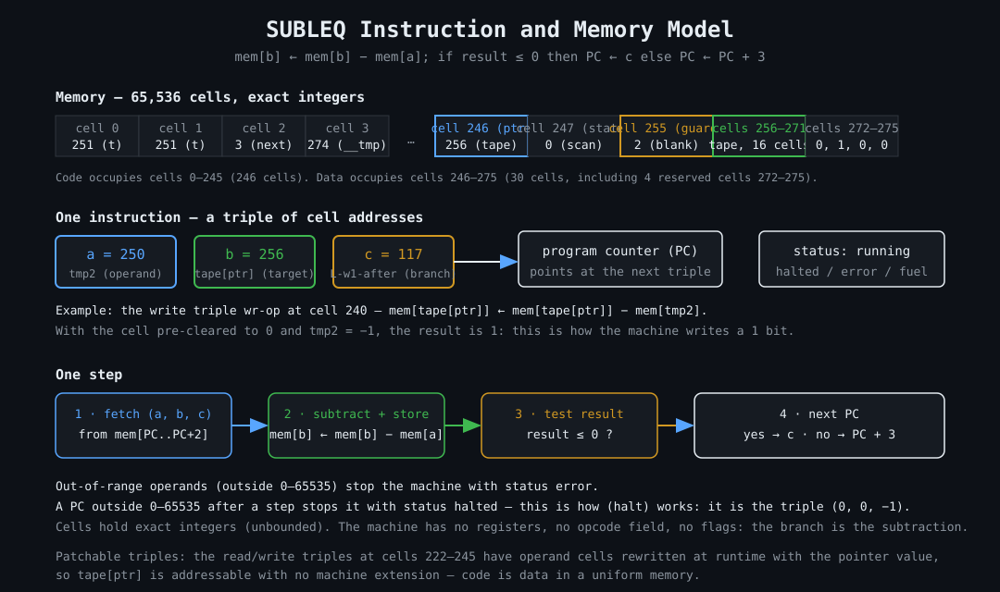
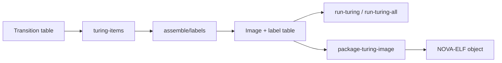
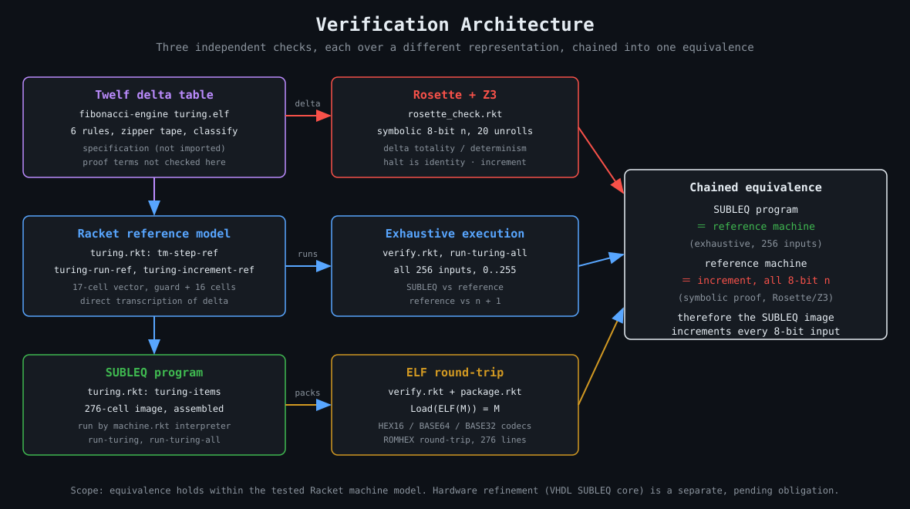
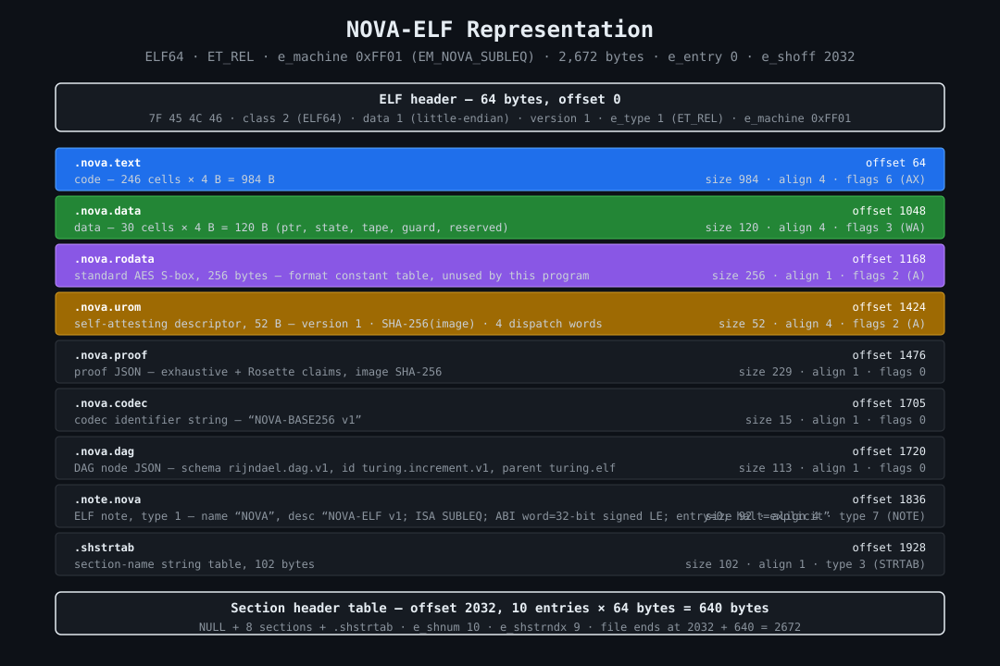

# SUBLEQ Turing Increment

## Turing-Machine Lowering, One-Instruction Computation, and Formal Verification

A binary-increment Turing machine, lowered to pure SUBLEQ microcode and packaged as NOVA-ELF. The machine accepts an 8-bit unsigned integer written most-significant-bit first on its tape and increments it. The source transition semantics are transcribed from the Twelf specification `Fibonacci-Engine/elf/transitions/turing.elf`; that Twelf source and its proof terms are not included in this repository. Only the transition table and tape semantics are re-expressed here, as a SUBLEQ lowering and a Racket reference model.

The repository is a compiler and its evidence in one place. A transition table becomes a SUBLEQ program. The SUBLEQ program runs on a one-instruction machine. The result agrees with a reference model on every 8-bit input, the reference model is proved to compute $n+1$ for a symbolic 8-bit input, and the verified image ships as a NOVA-ELF object that round-trips through its codecs and reloads to the identical image. The chain is:

$$\text{Twelf specification} \;\to\; \text{Racket reference model} \;\to\; \text{SUBLEQ program} \;\to\; \text{NOVA-ELF object}$$

with the reference model checked against the SUBLEQ program by exhaustive execution and against the increment function by symbolic proof. The SUBLEQ program is not proved equivalent to the reference by a theorem; it is compared to the reference on all 256 inputs. The reference is proved to compute $n+1$ for all 8-bit inputs. The two links together give the increment property for the shipped program over its input domain.

## At a glance

| Property | Value |
| --- | --- |
| Operation | Increment an unsigned binary integer |
| Input | 8-bit value, most-significant bit first |
| Output | 9-bit result on overflow (`255 → 256`); otherwise 8 bits |
| Turing states | `scan`, `carry`, `halt` |
| Tape symbols | `0`, `1`, blank (`2`) |
| Target | SUBLEQ, one instruction, 65,536 cells of memory |
| Tape access | Patchable instruction triples for indirect access through a head pointer |
| Machine extension | None. Code is data in a uniform memory |
| Image | 276 cells (246 code + 30 data, data includes 4 reserved cells) |
| Image SHA-256 | `fe289e0931f7bd3a19fe394422213400986fb846b2094700b70914765340d099` |
| NOVA-ELF object | 2,672 bytes |
| NOVA-ELF SHA-256 | `db67a7a8493da66f6151607426fc6e6d705d15fd3ea54d3ac058722ea84cfc63` |
| Exhaustive check | 0 mismatches / 256 inputs (SUBLEQ vs reference, reference vs `n+1`) |
| Symbolic proof | Rosette/Z3: delta totality/determinism, halt-is-identity, increment for all 8-bit inputs |
| SUBLEQ steps | 247 minimum (`n = 0`); 580 maximum (`n = 255`); average `39153/128` (≈ 305.9) |
| Constant-trace | No. Step count depends on scan and carry lengths |
| Implementation language | Racket; Rosette/Z3 for symbolic checks |
| License | SNAPKITTY OPAQUE SOURCE LICENSE v1.0 |

## How it works

The machine scans right to the blank after the input, then moves left carrying the increment. It changes trailing `1`s to `0`s; at the first `0` (or at the left guard blank), it writes `1` and halts. For `255`, the guard cell becomes the ninth result bit.





### Transition table

| State | Read | Write | Move | Next state |
| --- | --- | --- | --- | --- |
| scan | `0` | `0` | Right | scan |
| scan | `1` | `1` | Right | scan |
| scan | blank | blank | Left | carry |
| carry | `1` | `0` | Left | carry |
| carry | `0` | `1` | Stay | halt |
| carry | blank | `1` | Stay | halt |

The table is total over the non-halt states: every `(state, symbol)` pair with `state` in `{scan, carry}` and `symbol` in `{0, 1, blank}` has exactly one rule. The halt state has no rule; a step in halt is the identity. Rosette proves this totality and determinism symbolically (see [Formal verification](#formal-verification)).

The SUBLEQ program runs on a uniform memory where code and data share the same address space. Runtime-patched triples implement indirect reads and writes through the tape-head pointer. No SUBLEQ machine extension is added.



## Mathematical foundations

### The Turing machine

The machine is the tuple $M = (Q, \Sigma, \Gamma, \delta, q_0, q_{accept}, q_{reject})$:

| Component | Definition in this repository |
| --- | --- |
| $Q$ | $\{scan, carry, halt\}$, encoded `0`, `1`, `2` |
| $\Sigma$ | $\{0, 1\}$, the input alphabet |
| $\Gamma$ | $\{0, 1, 2\}$, where `2` is the blank |
| $\delta$ | The six-rule transition table above |
| $q_0$ | `scan`, head at the first input cell |
| $q_{accept}$ | `halt`, reached by writing `1` in carry |
| $q_{reject}$ | None. The machine halts on every input in the domain |

The transition function has the form $\delta(q, a) = (q', b, d)$: in state $q$ reading symbol $a$, write symbol $b$, move the head in direction $d \in \{L, R, S\}$, and enter state $q'$. In the scan state the machine copies each symbol unchanged and moves right; the scan state is a pure rightward walk to the end of the input. At the blank the machine turns left and enters carry. In the carry state the machine flips trailing `1`s to `0`s and moves left; at the first `0` it writes `1`, stays, and halts; at the blank it writes `1`, stays, and halts. The carry state is binary addition with the carry propagating left through the trailing ones.

### The increment operation

For an 8-bit input $n$, the machine computes $n + 1$:

| Input | Tape before | Tape after | Result |
| --- | --- | --- | --- |
| `00001111` (15) | `0 0 0 0 1 1 1 1` | `0 0 0 1 0 0 0 0` | `00010000` (16) |
| `01111111` (127) | `0 1 1 1 1 1 1 1` | `1 0 0 0 0 0 0 0` | `10000000` (128) |
| `11111111` (255) | `1 1 1 1 1 1 1 1` | `1 0 0 0 0 0 0 0` (9 bits) | `100000000` (256) |

Overflow does not wrap. The tape has a guard cell immediately before the input field, initially blank. When the carry runs off the left end of the field — the all-ones case — the head reads the guard blank, writes `1`, and halts. The guard becomes the ninth result bit. The result of `255` is `256`, not `0`. The output width is 9 bits on overflow and 8 bits otherwise.

The number of Turing steps is bounded: at most 9 scan steps (8 input cells plus the blank) and at most 9 carry steps (8 flipped ones plus the guard), so at most 18 transitions to halt for any 8-bit input. The Rosette increment proof unrolls 20 steps, more than the 18-step maximum, with the step function acting as the identity at halt, so the extra unrolled steps are harmless.

### The SUBLEQ instruction

SUBLEQ is a one-instruction computer. Every instruction is a triple $(a, b, c)$ of memory addresses. The machine executes:

$$\text{mem}[b] \leftarrow \text{mem}[b] - \text{mem}[a]$$

$$\text{if } \text{mem}[b] \le 0: \; PC \leftarrow c \quad \text{else} \; PC \leftarrow PC + 3$$

This is the exact semantics implemented by `machine-step!` in `subleq-isa-racket/subleq/machine.rkt`: the result is stored back into `mem[b]`, and the next program counter is `c` when the result is less than or equal to zero, otherwise the address of the next triple. The branch condition is `<= 0`, not `< 0` and not `== 0`. A zero result branches. A positive result falls through.

The machine has 65,536 cells of memory. Cells hold exact integers (unbounded in the Racket simulator; the NOVA-ELF serialization uses 32-bit signed little-endian words). A step whose `a` or `b` operand falls outside `[0, 65535]` stops the machine with status `'error`. A program counter outside `[0, 65535]` after a step stops the machine with status `'halted`; this is how the program halts, by jumping to address `-1`. Running out of fuel (1,000,000 steps by default in `machine-run`) stops it with status `'fuel`.

All control flow and computation in the lowered program emerge from this one operation. Comparison is subtraction followed by the branch: `jle` tests whether a cell is `<= 0` by subtracting zero from it; `jpos` tests whether a cell is `> 0` by subtracting zero and branching the other way. Assignment is subtraction against a cleared cell: `mov` clears the destination, then adds the source through a scratch cell. Addition is subtraction of a negated value. The assembler lifts these patterns into a named instruction layer (see [The assembler](#the-assembler)).

### Tape encoding

The reference model holds the tape as a vector of 17 cells: index `0` is the guard, indices `1..16` are the tape cells. Symbols are `0`, `1`, `2` (blank). The head is an index into this vector. The input occupies cells `1..8`, most-significant bit first; the remaining tape cells and the guard start blank.

The SUBLEQ program holds the tape as 16 cells in memory starting at the `tape` label (address 256), with the `guard` cell immediately before it at address 255. The head is a pointer cell `ptr` (address 246) holding the address of the current tape cell; it starts at the tape base and moves by increment and decrement. The head range is `[guard, tape+8]`: the guard at the left end, the blank past the least-significant bit at the right end.

The two encodings agree on the field that matters: cells `1..8` of the reference tape are the 8 input bits, and cells `tape+0..tape+7` of the SUBLEQ tape are the same 8 bits. The guard is cell `0` of the reference vector and cell `tape-1` of the SUBLEQ memory. The blank past the least-significant bit is cell `9` of the reference vector (in the Rosette encoding) and cell `tape+8` of the SUBLEQ memory.

Result extraction reads the guard first. If the guard cell is `1`, the result is 9 bits: the guard plus the 8 tape cells. Otherwise the result is the 8 tape cells. Blank cells inside the field count as `0` if present; they do not occur in a completed run.

### The lowering mapping

Lowering is a function from the transition table to a list of assembler items. Each Turing step becomes a fixed sequence of SUBLEQ triples through the main loop; the loop dispatches on state, then on symbol, then acts. The mapping from source-level operations to SUBLEQ is:

| Source operation | SUBLEQ implementation |
| --- | --- |
| Halt check (`state == 2`) | `t ← state − 1`; branch to `halt` if `t > 0` |
| Read symbol (`sym ← tape[ptr]`) | Patch `rd-op` with `ptr`; `tmp ← −tape[ptr]`; `sym ← −tmp` |
| State dispatch | `jle state`: `state ≤ 0` (scan) branches; otherwise carry |
| Symbol dispatch | `jle sym` and `sym − 1` tests against `0` and `1`; fall-through is blank |
| Scan advance | `ptr ← ptr + 1` |
| Scan to carry | `ptr ← ptr − 1`; `state ← 1` |
| Carry flip `1 → 0` | Patch `wr0-clr` with `ptr`; `tape[ptr] ← tape[ptr] − tape[ptr]`; `ptr ← ptr − 1` |
| Carry write `1` | Patch `wr1-clr` with `ptr`; `tape[ptr] ← 0`; `tmp2 ← −1`; patch `wr-op` with `ptr`; `tape[ptr] ← 0 − (−1)` |
| Halt | `state ← 2`, then the halt triple jumps to address `−1` |

The lowering preserves the computation because each source operation is implemented by triples whose net effect on the machine state (tape cells, head pointer, state cell) is exactly the operation's effect, and the control-flow dispatch reproduces the transition table's case split. The preservation is checked, not assumed: the lowered program is run against the reference model on all 256 inputs, and the reference model is proved to compute `n+1` symbolically.



## The SUBLEQ machine

The target machine is the canonical SUBLEQ machine in `subleq-isa-racket/subleq/machine.rkt`. Its state is a memory vector of 65,536 cells, a program counter, and a status. The interface is four procedures:

| Procedure | Behavior |
| --- | --- |
| `make-machine` | Fresh machine: memory zeroed, `pc = 0`, status `'running` |
| `machine-load!` | Copies an image list into memory from address 0, resets `pc` and status |
| `machine-step!` | Executes one triple; updates memory, `pc`, and status |
| `machine-run` | Steps until the status leaves `'running` (halt, error, or fuel exhaustion) |

`machine-mem`, `machine-pc`, and `machine-status` read the state. `MEM-SIZE` is `65536`.

A step reads the triple at `pc`: addresses `a`, `b`, `c`. It computes `result = mem[b] − mem[a]`, stores the result into `mem[b]`, and sets the next `pc` to `c` when `result ≤ 0`, otherwise `pc + 3`. If the next `pc` is outside `[0, 65535]`, the status becomes `'halted`. The halt instruction is the triple `(0, 0, −1)`: it subtracts zero from zero, the result is zero, the branch is taken, and `pc` becomes `−1`, which is out of range, so the machine halts. The status `'halted` is the only successful termination; `'error` means an operand or program counter left the address space, and `'fuel` means the step budget ran out.

The machine is deterministic: the same image and the same initial memory always produce the same run. It is also the only machine the lowered program is checked against. No hardware SUBLEQ core exists for this image, so equivalence holds within this Racket machine model; hardware refinement is a separate, pending step (see [Scope](#scope)).



### The assembler

`assemble/labels` in `subleq-isa-racket/subleq/asm.rkt` turns a list of items into a flat image and a label table. Items are `(label name)`, `(word v ...)` literal cells, `(subleq a b [c])` raw triples, and macro instructions. Assembly is two passes: pass 1 assigns an address to every label, pass 2 emits the image with all operands resolved. Operands are numbers, labels, `'next` (the following address), or `(rel k)` (the address `k` cells after the start of the triple that carries it).

The macro layer lifts raw triples into a named instruction set. `A` and `B` are cells, `L` is a label:

| Macro | Expansion | Effect | Triples |
| --- | --- | --- | --- |
| `(clr A)` | `(A, A, next)` | `A ← 0` | 1 |
| `(sub A B)` | `(A, B, next)` | `B ← B − A` | 1 |
| `(add A B)` | three triples through `__tmp` | `B ← B + A`, `A` preserved | 3 |
| `(mov A B)` | `clr B` then `add A B` | `B ← A`, `A` preserved | 4 |
| `(neg A)` | `mov A __tmp2`, `clr A`, `(__tmp2, A, next)` | `A ← −A` | 6 |
| `(inc A)` | `add __one A` | `A ← A + 1` | 3 |
| `(dec A)` | `(__one, A, next)` | `A ← A − 1` | 1 |
| `(jmp L)` | `(__zero, __zero, L)` | unconditional branch | 1 |
| `(jle A L)` | `(__zero, A, L)` | branch to `L` if `mem[A] ≤ 0`, `A` unchanged | 1 |
| `(jpos A L)` | `(__zero, A, rel 6)` then `(__zero, __zero, L)` | branch to `L` if `mem[A] > 0`, `A` unchanged | 2 |
| `(halt)` | `(__zero, __zero, −1)` | stop the machine | 1 |
| `(word v ...)` | literal cells | data or raw triple operands | `len(v)` |

`jpos` costs one step when the tested cell is `≤ 0` (the first triple branches past the jump) and two steps when it is `> 0` (the first triple falls through to the jump). Every other macro costs its triple count on every execution. This asymmetry is part of the step-count model in [Performance and measurement](#performance-and-measurement).

The assembler reserves four cells after the program image: `__zero` (always 0), `__one` (always 1), `__tmp` and `__tmp2` (scratch). Macros clobber `__tmp` and `__tmp2`; programs treat the reserved cells as read-only except for those two. A label that collides with a reserved name is an assembly error, as is a duplicate label or an undefined label.

## The lowering pipeline

` turing-items` in `src/turing.rkt` returns the item list for the whole program: the main loop, the patchable triples, and the data cells. `assemble/labels` turns the list into the image and the label table. The pipeline is:



### Main loop

The main loop starts at address 0 (`step-loop`). Each iteration is one Turing step:

1. **Halt check.** `mov state t`, then `sub k1 t`, so `t = state − 1`. `jpos t L-halt` branches to the halt label when `t > 0`, which is exactly when `state = 2`. For `state` 0 or 1, `t ≤ 0`, and the `jpos` first triple branches past its jump, costing one step.
2. **Read.** `mov ptr rd-op` writes the current head pointer into the `A` operand cell of the `rd-op` triple. `clr tmp` zeroes the accumulator. `jmp rd-op` jumps to the patchable triple. `rd-op` computes `tmp ← tmp − mem[ptr]`, which is `−tape[ptr]` since `tmp` was cleared. Its result is `≤ 0` for every tape symbol, so it branches through its `C` operand directly to `rd-after`; the explicit jump after the triple never executes on this path. Then `clr sym` and `sub tmp sym` give `sym ← 0 − tmp = tape[ptr]`.
3. **State dispatch.** `jle state L-scan` branches to the scan block when `state ≤ 0` (scan is `0`) and falls through to carry when `state = 1`.
4. **Symbol dispatch.** Each block tests `sym` against `0` and `1` with `jle` and a subtraction against `k1`. Falling through both tests means `sym = 2`, the blank. The scan block advances the head or enters carry; the carry block writes `0` or `1` and either moves left or halts.
5. **Loop.** Every action path jumps back to `step-loop`.

### Patchable triples

Indirect access — reading and writing `tape[ptr]` where `ptr` varies at runtime — uses patchable triples: raw word triples placed after the halt, whose operand cells are rewritten at runtime with the pointer value before the triple is jumped to. This is pure SUBLEQ. Code is data in a uniform memory; the program writes an address into an instruction operand, then executes that instruction. No machine extension is involved.

| Triple | Cells | Operation | How it works |
| --- | --- | --- | --- |
| `rd-op` | 222–224 | `tmp ← −tape[ptr]` | `A` patched with `ptr`; `B` is `tmp` (cleared first); `C` is `rd-after` |
| `wr0-clr` | 228–230 | `tape[ptr] ← 0` | `A` and `B` patched with `ptr`; `tape[ptr] − tape[ptr] = 0`; `C` is `L-carry-1-after` |
| `wr1-clr` | 234–236 | `tape[ptr] ← 0` | `A` and `B` patched with `ptr`; `C` is `L-w1-mid` |
| `wr-op` | 240–242 | `tape[ptr] ← 1` | `A` is `tmp2` (holding `−1`); `B` patched with `ptr`; `C` is `L-w1-after` |

Writing `1` takes two triples because SUBLEQ has no immediate-load: `wr1-clr` clears the cell to `0`, then `tmp2` is set to `−1` (`clr tmp2`, `sub k1 tmp2`), and `wr-op` computes `tape[ptr] ← 0 − (−1) = 1`. Writing `0` takes one triple because subtracting a cell from itself is always zero.

Each patchable triple is followed by an explicit jump to its continuation. SUBLEQ branches to the `C` operand only when the result is `≤ 0`; otherwise it falls through to `triple + 3`. The write triple produces a positive result (`1`), so without the following jump the machine would fall through into the data cells. The `C` operand covers the `≤ 0` case and the jump covers the `> 0` case; both reach the same label. The read and clear triples always produce a result `≤ 0`, so their following jumps never execute — they exist so the fall-through case is covered if the operand ever holds a value that makes the result positive.

### Label map

The assembler resolves every label to an address. The code occupies addresses `0..245`; the data starts at `246`.

| Label | Address | Role |
| --- | --- | --- |
| `step-loop` | 0 | Main loop entry |
| `rd-after` | 39 | Continuation after the read triple |
| `L-carry-w1` | 69 | Carry write-1 path |
| `L-w1-mid` | 96 | Between the clear and the write in write-1 |
| `L-w1-after` | 117 | After the write-1 triple |
| `L-carry-0` | 132 | Carry symbol `0` path |
| `L-carry-1` | 135 | Carry symbol `1` path |
| `L-carry-1-after` | 162 | After the write-0 triple |
| `L-scan` | 168 | Scan block entry |
| `L-scan-adv` | 207 | Scan advance path |
| `L-halt` | 219 | Halt triple |
| `rd-op` | 222 | Patchable read triple |
| `wr0-clr` | 228 | Patchable write-0 triple |
| `wr0-clr-b` | 229 | Its `B` operand cell |
| `wr1-clr` | 234 | Patchable write-1 clear triple |
| `wr1-clr-b` | 235 | Its `B` operand cell |
| `wr-op` | 240 | Patchable write-1 triple |
| `wr-op-b` | 241 | Its `B` operand cell |
| `data-start` | 246 | First data cell; the code/data split |
| `ptr` | 246 | Head pointer cell (initial value `tape`) |
| `state` | 247 | State cell (`0` scan) |
| `sym` | 248 | Current symbol cell |
| `tmp` | 249 | Read accumulator |
| `tmp2` | 250 | Write-1 scratch (holds `−1`) |
| `t` | 251 | Comparison scratch |
| `k0` | 252 | Constant `0` |
| `k1` | 253 | Constant `1` |
| `k2` | 254 | Constant `2` |
| `guard` | 255 | Guard blank cell |
| `tape` | 256 | Tape base; 16 cells `256..271` |
| `__zero` | 272 | Reserved, always `0` |
| `__one` | 273 | Reserved, always `1` |
| `__tmp` | 274 | Reserved scratch |
| `__tmp2` | 275 | Reserved scratch |

### Image layout

The image is 276 cells. The code is the first 246 cells, everything before the `data-start` label. The data is the remaining 30 cells: 10 named cells (`ptr`, `state`, `sym`, `tmp`, `tmp2`, `t`, `k0`, `k1`, `k2`, `guard`), 16 tape cells, and the 4 reserved cells the assembler appends. The split is computed from the image's own labels by `turing-code-cells` and `turing-data-cells`, not hardcoded.

| Region | Addresses | Cells | Contents |
| --- | --- | --- | --- |
| Code | 0–245 | 246 | Main loop, dispatch, patchable triples |
| Data | 246–275 | 30 | Pointer, state, scratch, constants, guard, tape, reserved |
| Tape field | 256–271 | 16 | Input cells `256..263`, trailing blanks `264..271` |
| Reserved | 272–275 | 4 | `__zero = 0`, `__one = 1`, `__tmp = 0`, `__tmp2 = 0` |

The first cells of the image are the assembled triples of the main loop. Cell 0 holds `251` (the address of `t`, the `A` operand of the first `clr`), cell 1 holds `251`, cell 2 holds `3` (the next triple). The data cells at the end hold the initial values: `ptr = 256`, `state = 0`, `sym = 0`, `tmp = 0`, `tmp2 = 0`, `t = 0`, `k0 = 0`, `k1 = 1`, `k2 = 2`, `guard = 2`, then sixteen `2`s for the tape, then `0, 1, 0, 0` for the reserved cells.

## Module reference

| Module | Responsibility | Inputs | Outputs | Verification |
| --- | --- | --- | --- | --- |
| `src/turing.rkt` | Reference model, SUBLEQ emitter, runners, exhaustive test | 8-bit input `n` | Incremented number; assembled image; label table | Exhaustive 0/256 vs reference and vs `n+1` |
| `src/rosette_check.rkt` | Symbolic proofs of the transition semantics | Symbolic 8-bit `n` | Three proof verdicts | Z3 `unsat` for each `verify` query |
| `src/trace.rkt` | SUBLEQ-level Turing trace for one input | Input `n` (default 13) | Configuration per Turing step | Compared against the reference trace by inspection |
| `src/measure.rkt` | Image size and dynamic step measurements | None (iterates all 256 inputs) | Cell counts, min/max/average steps | Each run asserts `got = n + 1` |
| `src/package.rkt` | NOVA-ELF packaging for this image | Image, labels, digests, JSON strings | NOVA-ELF bytes; image reloaded from ELF | `Load(ELF(M)) = M` checked in `src/verify.rkt` |
| `src/verify.rkt` | End-to-end verification and artifact packaging | None (assembles and tests) | `artifact/` package, printed checks | All checks must pass or it errors |

### `src/turing.rkt`

The lowering engine and the reference model. It requires the SUBLEQ machine (`machine.rkt`) and the assembler (`asm.rkt`) from the sibling `subleq-isa-racket` project. `TAPE-CELLS` is `16`.

**Reference model.** `tm-state` is a transparent mutable struct with fields `tape`, `head`, `state`. The tape is a vector of 17 cells; the head is a vector index; the state is `0` scan, `1` carry, `2` halt. `tm-step-ref` implements the transition table directly: in scan it moves the head right on `0` or `1` and left into carry on blank; in carry it writes `0` and moves left on `1`, writes `1` and halts on `0` or blank; in halt it does nothing. `turing-run-ref` builds the initial tape (guard blank, cells `1..8` holding the input bits MSB-first), then steps with a fuel of 100 and errors if the machine has not halted. `turing-increment-ref` runs the reference machine and folds the result bits into a number, reading 9 bits when the guard became `1` and 8 bits otherwise.

**Bit conversion.** `number->tape-bits` returns the bits of `n` MSB-first, exactly `w` bits, by shifting and masking. `tape-bits->number` folds a list of bits MSB-first into a number; a blank cell (`2`) inside the field counts as `0` if present.

**Emitter.** `turing-items` returns the item list: the main loop, the patchable triples, and the data cells. The items are assembler source, not the image; `assemble/labels` resolves them. The data section defines `ptr` (initial value `tape`), `state` (`0`), `sym`, `tmp`, `tmp2`, `t` (all `0`), `k0` (`0`), `k1` (`1`), `k2` (`2`), `guard` (`2`), and `tape` (sixteen `2`s).

**Runners.** `run-turing` assembles the image, loads it into a fresh machine, writes the input bits into the tape cells, runs to halt, and returns the result from `extract-result`. It errors if the machine does not halt or halts in the wrong state. `run-turing-steps` does the same but steps the machine one triple at a time and counts steps, returning the result, the step count, and the status. `extract-result` reads the guard cell at `tape-addr − 1` and folds either 9 bits (guard `1`) or 8 bits into the result number.

**Exhaustive test.** `run-turing-all` runs the SUBLEQ program on all 256 inputs, compares each result with `turing-increment-ref` and with `n + 1`, counts mismatches in both comparisons, prints the first 10 of each kind, and reports the totals and the image size. It assembles the image once and reuses it across all 256 runs.

```racket
(run-turing 13)        ; => 14
(run-turing 255)       ; => 256
(run-turing-all)       ; 0 mismatches / 256, both comparisons
```

### `src/rosette_check.rkt`

The symbolic proofs. It is a `#lang rosette` module; it does not import `src/turing.rkt`. It re-encodes the transition table and the step function as Rosette bitvector operations and asks Z3 to verify three properties. The tape is a 20-bit bitvector: 10 cells of 2 bits each, cell `i` occupying bits `[2i+1 : 2i]`. The head is a 4-bit index (`0..9`); cell `0` is the guard, cells `1..8` hold the input, cell `9` is the blank past the least-significant bit. The state is 2 bits (`0` scan, `1` carry, `2` halt). The move is 2 bits (`0` left, `1` stay, `2` right).

`cell-at` extracts the 2-bit cell at the head by shifting right and masking with `3`. `write-cell` clears the target cell with an inverted shifted mask and ORs the new value in. `delta` returns a list `(write move next-state)` for the six non-halt cases and a default for the unreachable else branch. `tm-step` returns the configuration unchanged at halt and otherwise applies `delta` to the current cell. `move-head` subtracts 1 for left, adds 1 for right, and leaves the head unchanged for stay.

The proofs are in [Formal verification](#formal-verification).

### `src/trace.rkt`

The SUBLEQ-level trace. `trace-one` assembles the image, loads it, writes the input bits, and steps the machine one triple at a time. Each time execution reaches the top of the main loop (`pc = step-loop`), it prints the Turing-level configuration: the step number, the state cell, the head relative to the tape base, and the tape snapshot from the guard through `tape+8`. When the machine halts it prints the result, the expected `n + 1`, and the status. The module runs `trace-one` on the command-line argument, defaulting to `13`.

The trace shows the SUBLEQ program actually walking through the expected Turing configurations, not just producing the right final answer. The head in the trace is `ptr − tape-addr`, so `0..7` are the input cells, `8` is the blank past the least-significant bit, and `−1` is the guard.

### `src/measure.rkt`

The measurements. It assembles the image once, prints the cell counts (`image cells = 276 (code 246 + data 30, data includes 4 reserved cells)`), then runs `run-turing-steps` on all 256 inputs, asserting each result equals `n + 1`, and tracks the minimum, maximum, and total step counts and the inputs that attain the extremes. It prints the min, max, and average, and states that the step count varies with the input. The measurements are in [Performance and measurement](#performance-and-measurement).

### `src/package.rkt`

The NOVA-ELF packaging for this image. It mirrors the GF packaging (`nova-elf/elf/package.rkt`) but computes the code/data split from this image's own labels instead of hardcoding the GF split. `turing-code-cells` returns the `data-start` label address; `turing-data-cells` returns the image length minus that address. `image-sha256-hex` hashes the canonical binary image — the cells serialized as 32-bit signed little-endian words — and returns the lowercase hex digest.

`package-turing-image` takes the image, the labels, the image digest, and the proof and DAG JSON strings, and returns the NOVA-ELF file as bytes. It splits the image into code and data at `data-start`, builds the `.nova.urom` content (descriptor version `1`, the image digest, and the four dispatch words), and passes eight sections to `nova-elf-write`. `load-turing-image` parses a NOVA-ELF file with `nova-elf-read`, extracts `.nova.text` and `.nova.data`, converts the bytes back to cells (32-bit signed little-endian), and appends them into the flat image. Whether the loaded image equals the original is the caller's check, performed in `src/verify.rkt`.

Two fields differ from the GF object by design. The `.nova.urom` descriptor is self-attesting: its digest is the SHA-256 of this canonical image, and its dispatch words are `VERIFY_MANIFEST`, `LOCK_IMMUTABLE`, `EXEC_INNER` with `inner_pc = 0` (the Turing program entry), `HALT`. The GF descriptor attests the NovaDag outer-ROM manifest digest and dispatches to `inner_pc = 0x040`; this image has no outer ROM and no DAG manifest yet. The `.nova.rodata` section carries the standard AES S-box as the format's constant table. The Turing program does not use it; it is included so the object is structurally identical to the GF object for loader compatibility.

### `src/verify.rkt`

The end-to-end verification and artifact packaging. It assembles the image, prints the cell counts and the image SHA-256, writes `artifact/turing_increment.mem` (one integer per line), runs the exhaustive 256-input test (SUBLEQ vs reference, reference vs `n + 1`), writes `artifact/evidence.txt`, packages the image as NOVA-ELF, checks the loader round-trip (`Load(ELF(M)) = M`), checks the ELF round-trips through HEX16, BASE64, and BASE32, runs the increment test from the ELF-loaded image on all 256 inputs, checks the ROMHEX round-trip, and writes the ELF, ROMHEX, HEX16, BASE64, manifest, and node record into `artifact/`. Every check is a `check` call that errors on failure; a run that completes has passed all of them. The full check list is in [Formal verification](#formal-verification).

## Machine walkthrough

Three inputs, each traced by execution with `src/trace.rkt`. The head is reported relative to the tape base: `0..7` are the input cells, `8` is the blank past the least-significant bit, `−1` is the guard. The tape snapshot shows the guard, the 8 input cells, and the trailing blank.

### Input 13 → 14

Input `13` is `00001101`. The scan reads eight bits (`0, 0, 0, 0, 1, 1, 0, 1`), reaches the blank at head `8`, and enters carry. The carry flips `tape[7]` from `1` to `0` and moves left; at `tape[6]` it reads `0`, writes `1`, and halts. The result is `00001110` (`14`).

| Turing step | State | Head | Tape (guard, cells 0–7, blank) |
| --- | --- | --- | --- |
| 0 | scan (0) | 0 | `2 0 0 0 0 1 1 0 1 2` |
| 1 | scan (0) | 1 | `2 0 0 0 0 1 1 0 1 2` |
| 2 | scan (0) | 2 | `2 0 0 0 0 1 1 0 1 2` |
| 3 | scan (0) | 3 | `2 0 0 0 0 1 1 0 1 2` |
| 4 | scan (0) | 4 | `2 0 0 0 0 1 1 0 1 2` |
| 5 | scan (0) | 5 | `2 0 0 0 0 1 1 0 1 2` |
| 6 | scan (0) | 6 | `2 0 0 0 0 1 1 0 1 2` |
| 7 | scan (0) | 7 | `2 0 0 0 0 1 1 0 1 2` |
| 8 | scan (0) | 8 | `2 0 0 0 0 1 1 0 1 2` |
| 9 | carry (1) | 7 | `2 0 0 0 0 1 1 0 1 2` |
| 10 | carry (1) | 6 | `2 0 0 0 0 1 1 0 0 2` |
| 11 | halt (2) | 6 | `2 0 0 0 0 1 1 1 0 2` |

12 Turing configurations, 11 transitions, 300 SUBLEQ steps. The carry is one cell deep: a single trailing `1` flips to `0`, and the next cell is `0`, so the carry stops immediately.

### Input 0 → 1

Input `0` is `00000000`. The scan reads eight zeroes, reaches the blank, and enters carry. The carry reads `tape[7] = 0`, writes `1`, and halts at once. The result is `00000001` (`1`).

| Turing step | State | Head | Tape (guard, cells 0–7, blank) |
| --- | --- | --- | --- |
| 0 | scan (0) | 0 | `2 0 0 0 0 0 0 0 0 2` |
| 1–8 | scan (0) | 1–8 | `2 0 0 0 0 0 0 0 0 2` |
| 9 | carry (1) | 7 | `2 0 0 0 0 0 0 0 0 2` |
| 10 | halt (2) | 7 | `2 0 0 0 0 0 0 0 1 2` |

11 Turing configurations, 10 transitions, 247 SUBLEQ steps — the minimum over the input domain. No trailing ones means no carry propagation; the increment lands on the least-significant bit.

### Input 255 → 256

Input `255` is `11111111`. The scan reads eight ones, reaches the blank, and enters carry. The carry flips every input cell from `1` to `0`, moving left through heads `7` down to `0`, then reads the guard blank at head `−1`, writes `1`, and halts. The guard becomes the ninth result bit. The result is `1 00000000` (`256`).

| Turing step | State | Head | Tape (guard, cells 0–7, blank) |
| --- | --- | --- | --- |
| 0–8 | scan (0) | 0–8 | `2 1 1 1 1 1 1 1 1 2` |
| 9 | carry (1) | 7 | `2 1 1 1 1 1 1 1 1 2` |
| 10 | carry (1) | 6 | `2 1 1 1 1 1 1 1 0 2` |
| 11 | carry (1) | 5 | `2 1 1 1 1 1 1 0 0 2` |
| 12 | carry (1) | 4 | `2 1 1 1 1 1 0 0 0 2` |
| 13 | carry (1) | 3 | `2 1 1 1 1 0 0 0 0 2` |
| 14 | carry (1) | 2 | `2 1 1 1 0 0 0 0 0 2` |
| 15 | carry (1) | 1 | `2 1 1 0 0 0 0 0 0 2` |
| 16 | carry (1) | 0 | `2 1 0 0 0 0 0 0 0 2` |
| 17 | carry (1) | −1 | `2 0 0 0 0 0 0 0 0 2` |
| 18 | halt (2) | −1 | `1 0 0 0 0 0 0 0 0 2` |

19 Turing configurations, 18 transitions (the maximum: 9 scan + 9 carry), 580 SUBLEQ steps — the maximum over the input domain. The carry propagates through all eight input cells and into the guard. This is the only input that uses the guard cell as a result bit.

### Instruction-level walkthrough: one scan iteration

One scan iteration over a `0` symbol, starting at `step-loop` (address 0) with `state = 0`, `sym` unread, `ptr` at the current cell:

| PC | Instruction | Effect | Steps |
| --- | --- | --- | --- |
| 0 | `mov state t` | `t ← state` (clear `t`, add `state` through `__tmp`) | 4 |
| 12 | `sub k1 t` | `t ← state − 1` | 1 |
| 15 | `jpos t L-halt` | `t ≤ 0`, first triple branches past the jump | 1 |
| 21 | `mov ptr rd-op` | `rd-op`'s `A` operand cell `← ptr` | 4 |
| 33 | `clr tmp` | `tmp ← 0` | 1 |
| 36 | `jmp rd-op` | `PC ← 222` | 1 |
| 222 | `rd-op` triple | `tmp ← 0 − tape[ptr] = −tape[ptr]`; result `≤ 0`, branch to `rd-after` | 1 |
| 39 | `clr sym` | `sym ← 0` | 1 |
| 42 | `sub tmp sym` | `sym ← 0 − tmp = tape[ptr]` | 1 |
| 45 | `jle state L-scan` | `state = 0 ≤ 0`, branch to `168` | 1 |
| 168 | `jle sym L-scan-adv` | `sym = 0 ≤ 0`, branch to `207` | 1 |
| 207 | `inc ptr` | `ptr ← ptr + 1` (three triples through `__tmp`) | 3 |
| 216 | `jmp step-loop` | `PC ← 0` | 1 |

Total: 21 SUBLEQ steps per scan iteration over a `0`. The `jmp rd-after` after `rd-op` never executes on this path because the read triple's result is always `≤ 0`; it exists for the fall-through case. A scan iteration over a `1` costs 27 steps: the same prefix, then `jle sym` falls through, `mov sym t` and `sub k1 t` compute `t = 0`, and `jle t` branches to the advance path. A scan iteration over the blank costs 29 steps: both symbol tests fall through, `dec ptr` moves the head left, and `mov k1 state` sets the state to carry.

### Instruction-level walkthrough: one carry iteration writing 0

One carry iteration over a `1` symbol, starting at `step-loop` with `state = 1`:

| PC | Instruction | Effect | Steps |
| --- | --- | --- | --- |
| 0–38 | Halt check, read, `sym ← tape[ptr]` | Same prefix as the scan iteration | 13 |
| 39 | `clr sym` | `sym ← 0` | 1 |
| 42 | `sub tmp sym` | `sym ← tape[ptr]` | 1 |
| 45 | `jle state L-scan` | `state = 1 > 0`, fall through to `48` | 1 |
| 48 | `jle sym L-carry-0` | `sym = 1 > 0`, fall through to `51` | 1 |
| 51 | `mov sym t` | `t ← sym` | 4 |
| 63 | `sub k1 t` | `t ← sym − 1 = 0` | 1 |
| 66 | `jle t L-carry-1` | `t = 0 ≤ 0`, branch to `135` | 1 |
| 135 | `mov ptr wr0-clr` | `wr0-clr`'s `A` operand cell `← ptr` | 4 |
| 147 | `mov ptr wr0-clr-b` | `wr0-clr`'s `B` operand cell `← ptr` | 4 |
| 159 | `jmp wr0-clr` | `PC ← 228` | 1 |
| 228 | `wr0-clr` triple | `tape[ptr] ← tape[ptr] − tape[ptr] = 0`; result `0 ≤ 0`, branch to `162` | 1 |
| 162 | `dec ptr` | `ptr ← ptr − 1` | 1 |
| 165 | `jmp step-loop` | `PC ← 0` | 1 |

Total: 35 SUBLEQ steps per carry iteration writing `0`. The `jmp L-carry-1-after` after `wr0-clr` never executes because the clear triple's result is always `0`. A carry iteration writing `1` costs 42 steps: the dispatch branches to the write-1 path, which clears the cell, sets `tmp2 ← −1`, and writes `1` through `wr-op` — the one triple whose result is positive (`1`), so its following jump does execute. A carry iteration on the blank costs 47 steps: the dispatch falls through both symbol tests into the write-1 path. The final halt costs 8 steps: `mov state t`, `sub k1 t`, the two triples of `jpos` (the state is `2`, so `t = 1 > 0` and the jump executes), and the halt triple.

## Formal verification

Verification in this repository is two links. The SUBLEQ program is compared with the reference model by exhaustive execution over all 256 inputs. The reference model is proved to compute `n + 1` by symbolic execution over a symbolic 8-bit input. Neither link alone is the whole claim; together they give the increment property for the shipped program over its input domain.



### Rosette and Z3

Rosette is a solver-aided language embedded in Racket. It lifts ordinary Racket code over symbolic values and discharges verification queries to an SMT solver — here Z3. `src/rosette_check.rkt` encodes the Turing machine semantics as bitvector operations, states the properties as assertions over symbolic inputs, and calls `verify`. `verify` asks Z3 whether the negation of the assertion is satisfiable. When Z3 returns `unsat`, no counterexample exists and the property holds for all inputs in the quantified domain. The three proofs run in about 1.7 seconds.

The encoding is deliberately small so the solver queries stay trivial. The tape is a 20-bit bitvector: 10 cells of 2 bits each, cell `i` occupying bits `[2i+1 : 2i]`. Cell `0` is the guard, cells `1..8` hold the input most-significant-bit first, cell `9` is the blank past the least-significant bit. The head is a 4-bit index. The state is 2 bits. The move is 2 bits (`0` left, `1` stay, `2` right). `cell-at` extracts a cell by shifting right and masking with `3`; `write-cell` clears the target cell with an inverted shifted mask and ORs the new value in. `delta` returns the triple `(write move next-state)` for the six non-halt cases. `tm-step` returns the configuration unchanged at halt and otherwise applies `delta` to the current cell.

### The three proofs

**Delta totality and determinism.** For every non-halt state (`scan`, `carry`) and every symbol (`0`, `1`, blank), `delta` returns exactly the table entry. The query introduces symbolic `state` (2 bits) and `sym` (20 bits), constrains `state < 2` and `sym < 3`, and asserts the conjunction of six implications, one per table row, each pinning the write, move, and next state. Z3 returns `unsat`: there is no `(state, symbol)` pair in the domain whose `delta` output differs from the table. The halt state has no rule, so totality is stated over the non-halt states only.

**Halt is identity.** A step in state `halt` changes nothing. The query introduces a symbolic tape (20 bits) and head (4 bits), applies `tm-step` at state `2`, and asserts the tape, head, and state are all unchanged. Z3 returns `unsat`. This is what makes the 20-step unrolling in the increment proof sound: once the machine halts, further steps cannot change the configuration.

**Increment for all 8-bit inputs.** For a symbolic 8-bit input `n`, after 20 unrolled steps the machine is halted and the tape holds `n + 1`. `init-tape` builds the initial tape: guard blank, cells `1..8` holding the bits of `n` most-significant-bit first, cell `9` blank. The unrolled loop applies `tm-step` 20 times — more than the 18-step maximum — and `extract-value` reads the result: 9 bits when the guard cell is `1`, otherwise 8 bits, with each cell contributing its bit value times $2^{8-c}$. The assertion is that the final state is halt and the extracted value equals `n + 1` as a 16-bit number. Z3 returns `unsat`.

One encoding detail matters: `cell-at` returns a 20-bit value, and zero-extending a 20-bit value to 16 bits is not a valid Rosette operation. `extract-value` narrows each cell to its low 2 bits first (`extract 1 0`), then zero-extends to 16 bits. The encoding is also validated concretely: the unrolled Rosette machine was run on concrete inputs `0, 1, 13, 127, 254, 255` and produced the right results before the symbolic proof was trusted.

### Verification matrix

| Property | Implementation | Method | Evidence |
| --- | --- | --- | --- |
| SUBLEQ vs reference | `run-turing-all` | Exhaustive execution, all 256 inputs | 0 mismatches / 256 |
| Reference vs `n + 1` | `run-turing-all` | Exhaustive execution, all 256 inputs | 0 mismatches / 256 |
| Delta totality/determinism | `src/rosette_check.rkt`, `delta-matches-table?` | Symbolic, Z3 `unsat` | PROVED |
| Halt is identity | `src/rosette_check.rkt`, `tm-step` at state 2 | Symbolic, Z3 `unsat` | PROVED |
| Increment, all 8-bit `n` | `src/rosette_check.rkt`, 20 unrolled steps | Symbolic, Z3 `unsat` | PROVED |
| ELF loader preserves image | `src/verify.rkt`, `load-turing-image` | Round-trip by execution | `Load(ELF(M)) = M` |
| ELF via HEX16 / BASE64 / BASE32 | `src/verify.rkt`, codec round-trips | Round-trip by execution | Decode(encode(ELF)) = ELF |
| Increment from ELF-loaded image | `src/verify.rkt` | Exhaustive execution, all 256 inputs | 0 mismatches / 256 |
| ROMHEX round-trip | `src/verify.rkt`, `nova-romhex-encode`/`decode` | Round-trip by execution | Decode(encode(cells)) = cells |
| Step-count model | `src/measure.rkt`, `run-turing-steps` | Execution over all 256 inputs | min 247, max 580, avg `39153/128` |

### What the checks do and do not establish

The exhaustive checks establish equivalence between the SUBLEQ program and the reference model over the 8-bit input domain, and between the reference model and `n + 1` over the same domain. They do not establish anything about inputs outside the domain, and they do not establish equivalence between the SUBLEQ program and the Twelf specification directly — the Twelf file is the source of the transcribed semantics, and its proof terms were not imported or checked with Twelf. The symbolic proofs establish properties of the transcribed semantics, not of the SUBLEQ program's execution: the SUBLEQ program's equivalence to the reference is the exhaustive link. The ELF checks establish that the packaged object loads back to the identical image and that the loaded image still computes the increment; they do not establish anything about the ELF format's security properties. The codecs are encodings, not encryption; a custom alphabet adds no cryptographic security.

### Scope

- **Hardware refinement: pending.** No VHDL SUBLEQ core exists for this image. Equivalence holds within the tested Racket machine model. A formal refinement proof that hardware faithfully implements this model is a separate, still-required step.
- **Constant-trace: not achieved and not claimed.** Step counts vary from 247 to 580 across the input domain. The program is the exhaustively tested baseline, not a constant-time implementation.
- **Twelf proofs: re-established, not imported.** Delta totality, determinism, and trace consistency were re-established by execution and by Rosette/Z3 over the transcribed semantics. The Twelf file was read as the specification; its proof terms were not checked with Twelf.

## NOVA-ELF binary format

NOVA-ELF is the binary object format for the NovaDag SUBLEQ stack. The container is ELF64; it does not force the virtual CPU to use 64-bit arithmetic. The SUBLEQ machine uses a 32-bit signed word (the v1 serialization choice), little-endian, with the instruction `(a, b, c)` word-addressed, entry at word address `0`, and an explicit halt. The object is relocatable (`ET_REL`) and is loaded by a dedicated NOVA loader, never executed as a native binary.



### ELF header

The file is 2,672 bytes. The header is the standard 64-byte ELF64 header with the machine identifier in the processor-specific reserved range.

| Field | Offset | Size | Value |
| --- | --- | --- | --- |
| `e_ident` magic | 0 | 4 | `7f 45 4c 46` (`\x7fELF`) |
| `e_ident` class | 4 | 1 | `2` (ELF64) |
| `e_ident` data | 5 | 1 | `1` (little-endian) |
| `e_ident` version | 6 | 1 | `1` |
| `e_type` | 16 | 2 | `1` (`ET_REL`) |
| `e_machine` | 18 | 2 | `0xFF01` (`EM_NOVA_SUBLEQ`, unregistered, v1 only) |
| `e_version` | 20 | 4 | `1` |
| `e_entry` | 24 | 8 | `0` (word address 0) |
| `e_phoff` | 32 | 8 | `0` (no program headers) |
| `e_shoff` | 40 | 8 | `2032` |
| `e_flags` | 48 | 4 | `0` |
| `e_ehsize` | 52 | 2 | `64` |
| `e_phentsize` | 54 | 2 | `0` |
| `e_phnum` | 56 | 2 | `0` |
| `e_shentsize` | 58 | 2 | `64` |
| `e_shnum` | 60 | 2 | `10` |
| `e_shstrndx` | 62 | 2 | `9` |

`e_machine` is `0xFF01`. It is in the processor-specific reserved range and is not a registered machine type. The first bytes of the file are `7f 45 4c 46 02 01 01 00 ...`, so the HEX16 encoding of the object begins `7f454c46`.

### Sections

Ten section headers, each 64 bytes, starting at offset 2032. Index 0 is the NULL section. The eight content sections are written in the order below, laid out after the 64-byte header with 8-byte alignment, and `.shstrtab` follows them.

| Index | Name | Type | Flags | Offset | Size | Align | Contents |
| --- | --- | --- | --- | --- | --- | --- | --- |
| 0 | (null) | 0 | 0 | 64 | 0 | 1 | — |
| 1 | `.nova.text` | 1 | 6 | 64 | 984 | 4 | 246 code cells as 32-bit signed LE |
| 2 | `.nova.data` | 1 | 3 | 1048 | 120 | 4 | 30 data cells as 32-bit signed LE |
| 3 | `.nova.rodata` | 1 | 2 | 1168 | 256 | 1 | Standard AES S-box, 256 bytes |
| 4 | `.nova.urom` | 1 | 2 | 1424 | 52 | 4 | Descriptor: version, digest, dispatch words |
| 5 | `.nova.proof` | 1 | 0 | 1476 | 229 | 1 | Proof JSON (UTF-8) |
| 6 | `.nova.codec` | 1 | 0 | 1705 | 15 | 1 | `NOVA-BASE256 v1` (UTF-8) |
| 7 | `.nova.dag` | 1 | 0 | 1720 | 113 | 1 | DAG node JSON (UTF-8) |
| 8 | `.note.nova` | 7 | 0 | 1836 | 92 | 4 | One note, name `NOVA`, type 1 (version) |
| 9 | `.shstrtab` | 3 | 0 | 1928 | 102 | 1 | NUL-separated section names |

`.nova.text` holds the 246 code cells (984 bytes); `.nova.data` holds the 30 data cells (120 bytes). Together they are the whole 276-cell image, split at the `data-start` label. `.nova.rodata` is the standard AES S-box, the format's constant table; the Turing program does not use it, and it is present so the object is structurally identical to the GF object for loader compatibility.

### The `.nova.urom` descriptor

The descriptor is 52 bytes: a `u32` version, a 32-byte digest, and four `u32` dispatch words.

| Field | Bytes | Value |
| --- | --- | --- |
| Version | 0–3 | `1` |
| Digest | 4–35 | SHA-256 of the canonical image: `fe289e0931f7bd3a19fe394422213400986fb846b2094700b70914765340d099` |
| `VERIFY_MANIFEST` | 36–39 | `0x20000000` |
| `LOCK_IMMUTABLE` | 40–43 | `0x40000000` |
| `EXEC_INNER` | 44–47 | `0x30000000` (`inner_pc = 0`, the Turing program entry) |
| `HALT` | 48–51 | `0xf0000000` |

The descriptor is self-attesting: its digest is the SHA-256 of this canonical image, not of an outer manifest. The GF object instead attests the NovaDag outer-ROM manifest digest and dispatches to `inner_pc = 0x040`; this image has no outer ROM and no DAG manifest yet. The digest is kept over the canonical binary image, not over any textual base encoding, so encodings can change without changing the identity of the underlying microcode.

### The `.note.nova` note

One note, name `NOVA`, type `1` (version). The layout is `namesz u32`, `descsz u32`, `type u32`, name padded to 4 bytes, description padded to 4 bytes. The name is `NOVA` (4 bytes, no padding needed). The description is the UTF-8 string `NOVA-ELF v1; ISA SUBLEQ; ABI word=32-bit signed LE; entry=0; halt=explicit` (74 bytes, padded to 76). The note is 92 bytes total: 12 header bytes, 4 name bytes, 76 description bytes. The description records the ABI: the word is 32-bit signed little-endian, the entry is word address `0`, and the halt is explicit. Changing the arithmetic width can change behavior; the width is part of the ABI recorded here.

### The codec family

The NOVA base-encoding family is versioned and reversible. Every codec is bijective over its supported inputs: $D_c(E_c(B)) = B$. These are encodings, not encryption.

| Codec | Identifier | Alphabet | Use |
| --- | --- | --- | --- |
| NOVA-HEX16 | `NOVA-HEX16` | `0-9a-f`, 2 chars per byte | Human-readable bytes |
| NOVA-BASE32 | `NOVA-BASE32` | RFC 4648 `A-Z2-7`, `=` padding | Compact textual representation |
| NOVA-BASE64 | `NOVA-BASE64` | RFC 4648 | Transport and storage |
| NOVA-BASE256 | `NOVA-BASE256` | One byte per symbol | Binary identity |
| NOVA-BASE512 | `NOVA-BASE512` | Unicode `U+0100..U+02FF`, 9-bit symbols | Experimental |
| NOVA-ROMHEX | `NOVA-ROMHEX` | 8 hex digits address, 8 hex digits value | Word-addressed ROM initialization |

The object round-trips through HEX16, BASE64, and BASE32: decoding the encoding reproduces the original 2,672 bytes. The first 32 HEX16 characters of the object are `7f454c4602010100000000000000000001`; the BASE64 encoding begins `f0VMRgIBAQAAAAAAAAAAAAEAAf8B`. ROMHEX is word-addressed: one word per line, `ADDR VALUE` in 8 lowercase hex digits each, `#` comments, the value in two's complement. The first ROMHEX lines are:

```
00000000 000000fb
00000001 000000fb
00000002 00000003
00000003 00000112
00000004 00000112
```

The image's first cell is `251` (`0xfb`), the `A` operand of the first `clr` triple; the ROMHEX round-trip decodes back to the identical 276 cells.

### Loader contract

`load-turing-image` parses the ELF with `nova-elf-read`, which verifies the magic, the ELF64 class, the little-endian data encoding, and the `e_machine` value `0xFF01`, then reads the section headers and the `.shstrtab` to resolve section names. It extracts `.nova.text` and `.nova.data`, converts the bytes back to cells (32-bit signed little-endian, 4 bytes per cell), and appends them into the flat image. The loader does not check the digest; the caller checks `Load(ELF(M)) = M` by comparing the loaded image with the original, and `src/verify.rkt` does exactly that. The loaded image then runs the increment test on all 256 inputs with 0 mismatches, so the packaged object preserves both the bits and the behavior.

## Performance and measurement

`src/measure.rkt` reports the image size and the dynamic step counts over all 256 inputs. It assembles the image once, then runs `run-turing-steps` on every input, asserting each result equals `n + 1`, and tracks the minimum, maximum, and total step counts and the inputs that attain the extremes.

| Metric | Value |
| --- | --- |
| Image cells | 276 (code 246 + data 30, data includes 4 reserved cells) |
| NOVA-ELF bytes | 2,672 |
| ROMHEX lines | 276 |
| SUBLEQ steps, minimum | 247 (`n = 0`) |
| SUBLEQ steps, maximum | 580 (`n = 255`) |
| SUBLEQ steps, average | `39153 / 128` (≈ 305.9) |
| SUBLEQ steps, `n = 13` | 300 |
| Turing steps, maximum | 18 (9 scan + 9 carry) |
| Turing steps, `n = 13` | 11 |
| Turing steps, `n = 0` | 10 |
| Turing steps, `n = 255` | 18 |
| Rosette proof time | ≈ 1.7 s for all three proofs |
| `src/verify.rkt` runtime | ≈ 2.4 s end to end |

### Step-count model

The SUBLEQ step count for an input is determined exactly by the input's bits. Each Turing iteration costs a fixed number of SUBLEQ steps depending on the state and the symbol read:

| Iteration | Cost (SUBLEQ steps) |
| --- | --- |
| Scan over `0` | 21 |
| Scan over `1` | 27 |
| Scan over blank | 29 |
| Carry writing `0` (read `1`) | 35 |
| Carry writing `1` (read `0`) | 42 |
| Carry on blank (guard) | 47 |
| Halt | 8 |

The differences come from the dispatch paths. A scan over `0` branches at the first symbol test; a scan over `1` falls through one test and computes `sym − 1`; a scan over the blank falls through both tests and takes the longer path into carry. A carry writing `0` patches one triple and jumps; a carry writing `1` patches two triples and sets `tmp2 ← −1`; a carry on the blank falls through both symbol tests before entering the write-1 path. The halt costs 8 because `jpos` executes both of its triples when the state is `2`.

Let `p` be the population count of `n` (the number of `1` bits) and `z` be the number of trailing `1`s. The scan always reads 8 input bits and one blank, so the scan cost is $21(8 - p) + 27p + 29$. The carry flips `z` ones at 35 steps each, then writes `1` at 42 steps — except when `z = 8`, where the carry reads the guard blank at 47 steps instead. The halt costs 8. The total is:

$$\text{steps}(n) = 21(8 - p) + 27p + 29 + 35z + \begin{cases} 42 & z < 8 \\ 47 & z = 8 \end{cases} + 8$$

Checking the formula against the measured totals: for `n = 0` ($p = 0$, $z = 0$), $21 \cdot 8 + 29 + 42 + 8 = 247$. For `n = 13` ($p = 3$, $z = 1$), $21 \cdot 5 + 27 \cdot 3 + 29 + 35 + 42 + 8 = 300$. For `n = 255` ($p = 8$, $z = 8$), $27 \cdot 8 + 29 + 35 \cdot 8 + 47 + 8 = 580$. The formula reproduces the measured minimum, the measured maximum, and the `n = 13` trace exactly. The total over all 256 inputs is 39,153 steps, average `39153/128`.

The step count varies with the input because the scan length and the carry length are data-dependent: the scan cost grows with the number of `1` bits, and the carry cost grows with the number of trailing `1`s. The program is not constant-trace, and the step-count model is the evidence for that. A constant-trace version would need a different construction; the affine-function argument in `subleq-lowering/v2_analysis.md` (outside this repository) shows that a constant-trace SUBLEQ program computes an affine function of its inputs, and binary increment is not affine.

## Installation and reproduction

### Requirements

| Requirement | Purpose |
| --- | --- |
| Racket | Runs all six modules |
| Rosette and its solver dependencies | Runs `src/rosette_check.rkt` (needs Z3) |
| `../subleq-isa-racket` | Sibling checkout: the SUBLEQ machine and assembler |
| `../nova-elf` | Sibling checkout: the NOVA-ELF writer, codec, and package modules |

The imports use relative paths, so arrange the checkouts as siblings of this repository (or adjust the imports for the workspace). To check whether Rosette is installed, run `racket -l rosette`; consult the [Rosette project](https://github.com/emina/rosette) for installation instructions if needed.

### Obtain the repository

```sh
git clone https://github.com/AHMADALIPARR/subleq-turing
cd subleq-turing
```

### Run it

From the repository root:

```sh
# Run the end-to-end checks and regenerate artifact/.
racket src/verify.rkt

# Run the symbolic checks.
racket src/rosette_check.rkt

# Measure image size and SUBLEQ steps across all inputs.
racket src/measure.rkt

# Trace an input (defaults to 13).
racket src/trace.rkt
racket src/trace.rkt 255
```

To invoke the exhaustive comparison helper directly:

```sh
racket -e '(require "src/turing.rkt") (run-turing-all)'
```

`src/verify.rkt` writes generated files into `artifact/`, replacing files with the same names. `src/trace.rkt` prints the Turing-level configurations for one input; `src/measure.rkt` prints the image size and the step statistics over all 256 inputs; `src/rosette_check.rkt` prints the three proof verdicts.

## Repository structure

```
subleq-turing/
├── LICENSE
├── README.md
├── STATUS.md
├── artifact/
│   ├── evidence.txt
│   ├── manifest.json
│   ├── turing.increment.v1.json
│   ├── turing_increment.mem
│   ├── turing_increment.nova.b64
│   ├── turing_increment.nova.elf
│   ├── turing_increment.nova.hex16
│   └── turing_increment.nova.romhex
├── docs/
│   └── assets/
│       ├── architecture.svg
│       ├── nova-elf-layout.svg
│       ├── subleq-memory-model.svg
│       ├── turing-state-machine.svg
│       └── verification-pipeline.svg
├── measure.rkt
├── package.rkt
├── rosette_check.rkt
├── trace.rkt
├── turing.rkt
└── verify.rkt
```

| Path | Purpose |
| --- | --- |
| [`src/turing.rkt`](turing.rkt) | Turing reference model, SUBLEQ program construction, runners, and exhaustive comparison helper |
| [`src/rosette_check.rkt`](rosette_check.rkt) | Rosette/Z3 checks of the transition semantics, halt behavior, and increment property |
| [`src/verify.rkt`](verify.rkt) | End-to-end test, NOVA-ELF packaging, codec round-trips, and artifact generation |
| [`src/trace.rkt`](trace.rkt) | Prints the Turing-level configurations encountered for one input (defaults to `13`) |
| [`src/measure.rkt`](measure.rkt) | Reports image layout and SUBLEQ step counts over all 256 inputs |
| [`src/package.rkt`](package.rkt) | Converts the image to and from NOVA-ELF sections |
| [`artifact/`](artifact/) | Generated image, proof evidence, NOVA-ELF object and encodings, manifest, and node record |
| [`docs/assets/`](docs/assets/) | Architecture diagrams (SVG) |
| [`STATUS.md`](STATUS.md) | Detailed design notes, verification evidence, and limitations |
| [`LICENSE`](LICENSE) | Repository license terms |

## Generated artifacts

| File | Contents | SHA-256 |
| --- | --- | --- |
| `artifact/turing_increment.mem` | Canonical SUBLEQ image, one integer per line | `bbae902848dc0f834dd200c51d6dc18ee0956b2658a761526e8256a75ea7465f` |
| `artifact/turing_increment.nova.elf` | NOVA-ELF object, 2,672 bytes | `db67a7a8493da66f6151607426fc6e6d705d15fd3ea54d3ac058722ea84cfc63` |
| `artifact/turing_increment.nova.romhex` | ROMHEX-encoded image, 276 lines | `b8fb21e418d433d7eba5b59759fb840033b324b0d72edfff47767923beed8098` |
| `artifact/turing_increment.nova.hex16` | HEX16-encoded NOVA-ELF object, 5,344 bytes | `c4179b5f5f7442cecb673a3e6272f4ea02848c9f5e6a681e96a0157f7d36903d` |
| `artifact/turing_increment.nova.b64` | BASE64-encoded NOVA-ELF object, 3,564 bytes | `61a4ae7bfd989d03962a41004b3ffa3302943ebef7ef1b0689b0fc73715cbc2b` |
| `artifact/evidence.txt` | Concise verification evidence | `54f3d76a6f41fd3b585ac6ed9b9839cedde499eb537d2fce23d6de604edc5bd3` |
| `artifact/manifest.json` | Artifact metadata and digests | `b122ba40c9b92b5201e3ed8b74286f27e39d9e794ce22dd6a6adfb6839094adc` |
| `artifact/turing.increment.v1.json` | Node record for `turing.increment.v1` | `1454b4aabefeb1725e80b969a6bc7a9a8e3ebf877a8e4fce4cddac43cee37fe9` |

The canonical image digest (over the 276 cells serialized as 32-bit signed little-endian words) is `fe289e0931f7bd3a19fe394422213400986fb846b2094700b70914765340d099`. The node record identifies the artifact as `turing.increment.v1`, kind `implementation`, language `SUBLEQ`, operation `increment`, with parameters `input_bits = 8`, `output_bits = 9`, `word_bits = 32`, parent `fibonacci-engine:elf/transitions/turing.elf`, schema `rijndael.dag.v1`, and verification status `proved` within the tested machine model, with the hardware-refinement obligation pending.

## License

SNAPKITTY OPAQUE SOURCE LICENSE v1.0 (SPDX `LicenseRef-Sovereign-Leviathan-SL-AGPL3-001`, Copyright © 2026 SnapKitty West). See [`LICENSE`](LICENSE).

## References

- The Twelf specification of the binary-increment machine: `Fibonacci-Engine/elf/transitions/turing.elf` (source of the transcribed transition table and tape semantics; not included in this repository).
- The SUBLEQ machine and assembler: `subleq-isa-racket/subleq/machine.rkt` and `subleq-isa-racket/subleq/asm.rkt` (sibling checkout).
- The NOVA-ELF writer, parser, and codec family: `nova-elf/elf/elf.rkt` and `nova-elf/elf/codec.rkt` (sibling checkout).
- Rosette, the solver-aided language used for the symbolic proofs: https://github.com/emina/rosette.
- Detailed design notes, verification evidence, and limitations: [`STATUS.md`](STATUS.md).
