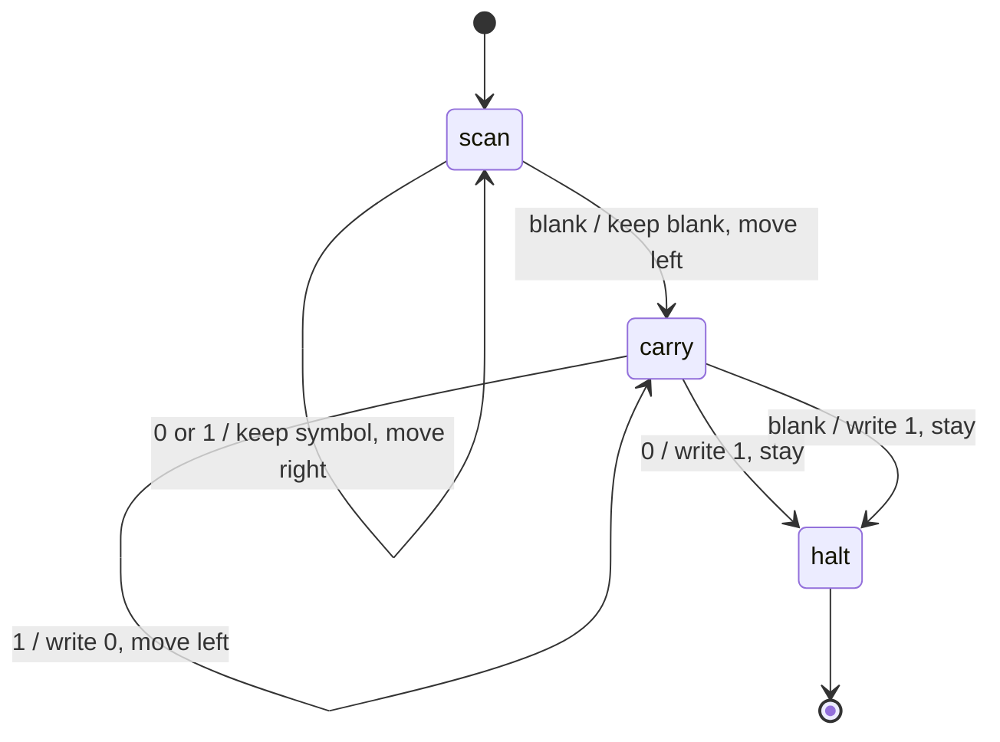
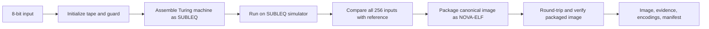

# SUBLEQ Turing Increment

A small, executable study in lowering a binary-increment Turing machine to **pure SUBLEQ**, checking its behavior, and packaging the resulting image as **NOVA-ELF**.

The machine accepts an 8-bit unsigned integer written MSB-first on its tape and increments it. The source transition semantics are transcribed from the Twelf specification `Fibonacci-Engine/elf/transitions/turing.elf`; that Twelf source and its proof terms are not included in this repository.

> **At a glance:** all 256 inputs are exhaustively checked; the SUBLEQ implementation agrees with the Racket reference model, and the reference model is symbolically proved to compute `n + 1`. This verifies the software model—not a hardware implementation.

## What it does

| Property | Details |
| --- | --- |
| Operation | Increment an unsigned binary integer |
| Input | 8-bit value, most-significant bit first |
| Output | 9-bit result on overflow (`255 → 256`); otherwise 8 bits |
| Turing states | `scan`, `carry`, `halt` |
| Tape symbols | `0`, `1`, blank (`2`) |
| Target | SUBLEQ, using patchable instruction triples for indirect tape access |
| Artifact | NOVA-ELF object plus image, encodings, manifest, and evidence |
| Implementation language | Racket; Rosette/Z3 is used for symbolic checks |

## How it works

The machine scans right to the blank after the input, then moves left carrying the increment. It changes trailing `1`s to `0`s; at the first `0` (or at the left guard blank), it writes `1` and halts. For `255`, the guard cell becomes the ninth result bit.



The SUBLEQ program runs on a uniform memory where code and data share the same address space. Runtime-patched triples implement indirect reads and writes through the tape-head pointer—no SUBLEQ machine extension is added.



### Transition table

| State | Read | Write | Move | Next state |
| --- | --- | --- | --- | --- |
| scan | `0` | `0` | Right | scan |
| scan | `1` | `1` | Right | scan |
| scan | blank | blank | Left | carry |
| carry | `1` | `0` | Left | carry |
| carry | `0` | `1` | Stay | halt |
| carry | blank | `1` | Stay | halt |

## Verification and measurements

| Check | Result | What it establishes |
| --- | --- | --- |
| SUBLEQ vs. reference model | 0 mismatches / 256 inputs | Exhaustive agreement over the 8-bit input domain |
| Reference model vs. `n + 1` | 0 mismatches / 256 inputs | The concrete reference result matches increment for every input |
| Rosette/Z3: transition table | Proved | The six non-halt state/symbol cases match the specified table |
| Rosette/Z3: halt behavior | Proved | A step in the halt state leaves the configuration unchanged |
| Rosette/Z3: increment | Proved | Symbolic 8-bit input produces `n + 1` in the reference semantics |
| NOVA-ELF image load | Round-trip passes | Loading the packaged text/data sections preserves the image |
| NOVA text encodings | Round-trips pass | HEX16, BASE64, and BASE32 encode/decode checks pass |
| ROMHEX | Round-trip passes | Decoding the encoded image reproduces the original cells |

| Image / execution metric | Value |
| --- | ---: |
| Canonical image | 276 cells (246 code + 30 data) |
| Image SHA-256 | `fe289e0931f7bd3a19fe394422213400986fb846b2094700b70914765340d099` |
| NOVA-ELF object | 2,672 bytes |
| NOVA-ELF SHA-256 | `db67a7a8493da66f6151607426fc6e6d705d15fd3ea54d3ac058722ea84cfc63` |
| SUBLEQ steps across inputs | 247 minimum (`n = 0`); 580 maximum (`n = 255`); average ≈305.9 |
| Constant-trace behavior | No—the step count depends on scan and carry lengths |

The symbolic proof applies to the transcribed Turing-machine semantics. The SUBLEQ program is compared to that reference exhaustively for all 256 inputs; the proofs do not directly prove SUBLEQ execution equivalent for inputs outside that domain. No VHDL SUBLEQ core is verified here, and a hardware refinement proof remains out of scope.

## Repository map

| Path | Purpose |
| --- | --- |
| `turing.rkt` | Turing reference model, SUBLEQ program construction, runners, and exhaustive comparison helper |
| `rosette_check.rkt` | Rosette/Z3 checks of the transition semantics, halt behavior, and increment property |
| `verify.rkt` | End-to-end test, NOVA-ELF packaging, codec round-trips, and artifact generation |
| `trace.rkt` | Prints the Turing-level configurations encountered for one input (defaults to `13`) |
| `measure.rkt` | Reports image layout and SUBLEQ step counts over all 256 inputs |
| `package.rkt` | Converts the image to and from NOVA-ELF sections |
| `artifact/` | Generated image, proof evidence, NOVA-ELF object and encodings, manifest, and node record |
| `STATUS.md` | Detailed design notes, verification evidence, and limitations |
| `LICENSE` | Repository license terms |

## Requirements

- Racket
- Rosette and its solver dependencies to run `rosette_check.rkt`
- The sibling projects referenced by the source files: `../subleq-isa-racket` and `../nova-elf`

The imports use relative paths, so arrange the checkouts as siblings of this repository (or adjust those imports for your workspace). To check whether Rosette is installed, try `racket -l rosette`; consult the [Rosette project](https://github.com/emina/rosette) for installation instructions if needed.

## Run it

From the repository root:

```sh
# Run the end-to-end checks and regenerate artifact/.
racket verify.rkt

# Run the symbolic checks.
racket rosette_check.rkt

# Measure image size and SUBLEQ steps across all inputs.
racket measure.rkt

# Trace an input (defaults to 13).
racket trace.rkt
racket trace.rkt 255
```

To invoke the exhaustive comparison helper directly:

```sh
racket -e '(require "turing.rkt") (run-turing-all)'
```

`verify.rkt` writes generated files into `artifact/`, replacing files with the same names.

## Generated artifacts

| File | Contents |
| --- | --- |
| `artifact/turing_increment.mem` | Canonical SUBLEQ image, one integer per line |
| `artifact/turing_increment.nova.elf` | NOVA-ELF object |
| `artifact/turing_increment.nova.romhex` | ROMHEX-encoded image |
| `artifact/turing_increment.nova.hex16` | HEX16-encoded NOVA-ELF object |
| `artifact/turing_increment.nova.b64` | BASE64-encoded NOVA-ELF object |
| `artifact/evidence.txt` | Concise verification evidence |
| `artifact/manifest.json` | Artifact metadata and digests |
| `artifact/turing.increment.v1.json` | Node record for `turing.increment.v1` |

## Example

The default trace demonstrates `13` (`00001101₂`) incrementing to `14` (`00001110₂`). The overflow case `255` produces `256` (`1 00000000₂`), with the guard cell supplying the ninth bit.

---

For the full verification record and known limitations, see [`STATUS.md`](STATUS.md).